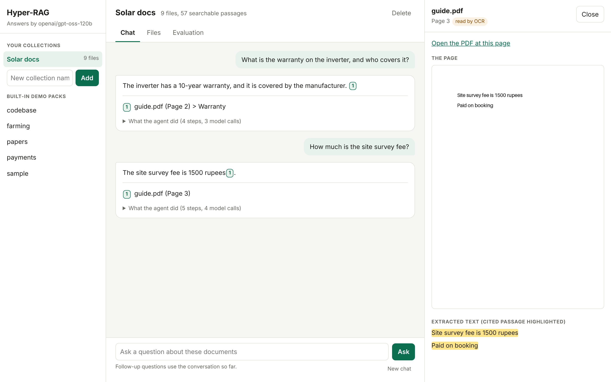
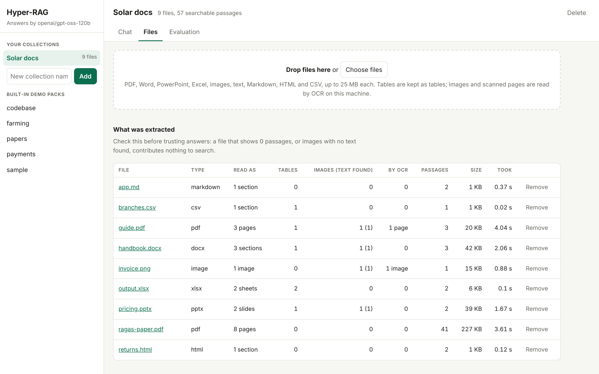
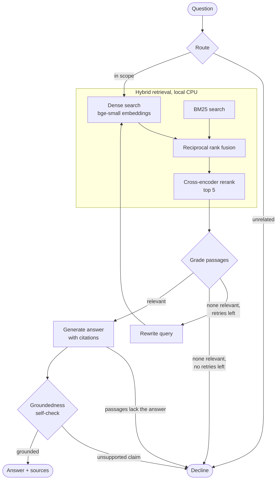

# Hyper-RAG

[](https://github.com/dhyan2815/Agent-Sandbox/actions/workflows/hyper-rag-ci.yml)

Upload your own documents (PDF, Word, PowerPoint, Excel, images, text) and ask questions
about them. Answers cite the page they came from, the system declines when the documents do
not support an answer, and an evaluation harness measures how well it does both.

- **Upload anything:** tables stay tables, text inside images and scanned pages is read by
  OCR on your machine, and a parse report shows what was extracted from every file.

- **Agent:** a LangGraph state machine that routes the question, retrieves, grades the
  passages, rewrites the query and retries when retrieval is weak, writes a cited answer and
  runs a groundedness self-check before releasing it.
- **Retrieval:** dense vectors + BM25, fused with reciprocal rank fusion, reranked by a
  cross-encoder. Embedding and reranking run locally on CPU.
- **Evaluation:** a golden question set per domain, retrieval metrics, answer metrics, and an
  ablation that shows what each component adds. Every number below comes from a run of the
  code in this repository, with the command that produced it.
- **Zero running cost:** generation uses Groq's free tier; tests and a full offline eval run
  with no API key and no network.



## Ask your own documents

```bash
uvicorn hyper_rag.api:app           # then open http://127.0.0.1:8000
```

Create a collection, drop files on the Files tab, ask on the Chat tab. Or from the terminal:

```bash
hyper-rag collection create "Solar docs"
hyper-rag collection add solar-docs guide.pdf handbook.docx pricing.pptx output.xlsx invoice.png
hyper-rag collection ask solar-docs "What is the warranty on the inverter?" --trace
hyper-rag collection eval solar-docs --questions 8
```

| Format | What is extracted | A citation points to |
|---|---|---|
| PDF | Text in reading order (two-column pages are read column by column), ruled tables, text in embedded images; pages with no text layer are read whole by OCR | Page |
| Word `.docx` | Headings, lists, tables, text in inline images | Section (top-level heading) |
| PowerPoint `.pptx` | Titles, text, tables, text in pictures, speaker notes | Slide |
| Excel `.xlsx` | Every non-empty sheet as a table, formulas as their last calculated value | Sheet |
| Images `.png .jpg .webp .bmp .tiff` | Text, by OCR | The image |
| `.txt .md .html .csv .tsv .json` | Text; CSV as a table | The file |

What you get on top of plain question answering:

- **Click-through citations.** Each `[n]` opens the page it cites: a rendering of the PDF
  page (or the image) and the extracted text with the cited sentences highlighted.
- **A parse report per file.** Pages, tables, images found, images OCR read text from, pages
  read by OCR, passages indexed, warnings. A file that contributes nothing to search says so.
- **Follow-up questions.** "And the battery?" is rewritten into a standalone question from the
  conversation before retrieval. The UI shows each agent step as it happens.
- **Auto-evaluation.** One click writes test questions from your documents' own passages and
  runs the same harness the domain packs use.



### What happened when I used it

One collection of nine files: one generated file per format (the fixtures in
`tests/make_files.py`: an invented solar installer's guide, handbook, price deck, output
sheet, invoice image and so on) plus a real two-column research paper
([arXiv 2309.15217](https://arxiv.org/abs/2309.15217)). 57 passages. Run on 2026-11-13
through the web UI with `openai/gpt-oss-120b` on Groq's free tier.

Seven questions asked by hand:

| Question | Where the answer is | Result |
|---|---|---|
| What is the warranty on the inverter, and who covers it? | Table in a PDF | Correct, cites page 2 |
| And the battery? (follow-up) | Same table | Correct |
| What is the support phone number? | Image embedded in a PDF page (OCR) | Correct |
| How much is the site survey fee? | Scanned PDF page (OCR) | Correct on the second run, see below |
| Subsidy for a 5 kW system and the payback period? | Slide table and slide picture (OCR) | Correct |
| Which three quality aspects does Ragas measure? | Two-column paper | Correct, cites page 3 |
| Who is the CEO of Northwind Solar? | Nowhere | Declined |

Auto-evaluation on six generated questions, no judge model
(saved in `results/uploads-demo-collection.json`):

| Configuration | Right page in top 5 | Contains the expected fact | Cites the right page | Wrongly declined | LLM calls |
|---|---|---|---|---|---|
| Hybrid + rerank, single shot | 6 of 6 | 4 of 5 | 1.0 | 0 of 6 | 1.0 |
| Full agent | 6 of 6 | 5 of 5 | 1.0 | 0 of 6 | 3.0 |

Read these as a smoke test. Six questions, each written by the model from the passage it is
then scored against, one run, and five of the six had a fact short enough to check by exact
match. Retrieval at 1.0 on questions like that says the index is intact, not that search is
solved.

Using it on real input found three bugs that the generated test files had not:

1. **Two-column PDFs were read straight across**, giving lines made of half a sentence from
   each column, and 9-point text lost its word spaces. Fixed: the parser now finds the column
   gap and uses a font-relative word spacing.
2. **The router declined the site-survey question.** Its picture of an uploaded collection
   is guessed from file names and headings, and the answer was on a scanned page with neither.
   Fixed: uploaded collections skip the router; grading decides.
3. **The first auto-evaluation scored correct answers as wrong** (0.4 to 0.5 on "contains the
   fact"), because the model had picked whole sentences and table fragments as the fact.
   Fixed: facts longer than four words are dropped.

The rest of this README covers the engine underneath and its measured evaluation on four
built-in domain packs.

## Results

Payments pack: 192 pages of Razorpay and Google Wallet developer documentation, 2,389
chunks, 38 golden questions (32 answerable, 6 unanswerable). Run on 2026-11-11.

**Retrieval** (`hyper-rag eval-retrieval payments`, no LLM involved)

| Retrieval mode | recall@5 | recall@10 | MRR | nDCG@10 | facts@5 |
|---|---|---|---|---|---|
| Vector only | 0.984 | 1.000 | 0.880 | 0.910 | 0.96 |
| Hybrid (vector + BM25, RRF) | 0.984 | 0.984 | 0.892 | 0.914 | 0.96 |
| Hybrid + rerank | 0.984 | 0.984 | 0.912 | 0.929 | 0.92 |

**Answers** (`hyper-rag eval payments --save`, generator `openai/gpt-oss-120b`, judge
`qwen/qwen3.8-27b`, both on Groq's free tier)

| Configuration | Correctness (judged) | Groundedness (judged) | Key facts present | Citation precision | Unanswerable declined | Answerable wrongly declined | LLM calls per question |
|---|---|---|---|---|---|---|---|
| Vector only, single shot | 0.922 | 0.906 | 0.84 | 0.875 | 6 of 6 | 0 of 32 | 1.0 |
| Hybrid, single shot | 0.953 | 0.812 | 0.88 | 0.828 | 6 of 6 | 0 of 32 | 1.0 |
| Hybrid + rerank, single shot | 0.938 | 0.906 | 0.84 | 0.927 | 6 of 6 | 0 of 32 | 1.0 |
| Full agent | 0.922 | 0.903 | 0.83 | 0.919 | 6 of 6 | 1 of 32 | 3.8 |

Every answer in every configuration carried at least one citation.

What these numbers say, including the parts that do not flatter the system:

1. **Plain vector search was already strong on this set.** Document-level recall@5 is 0.984
   in every mode. Hybrid search and reranking improve the ranking (MRR 0.880 to 0.912) and
   the share of citations that point at a correct page (0.875 to 0.927), not recall.
2. **Hybrid + rerank matters more on harder text.** On the research papers pack, recall@5
   rises from 0.933 to 1.000 and facts@5 from 0.786 to 0.929 (table below).
3. **On payments the agent did not beat single-shot RAG, and it costs 3.8 LLM calls instead
   of 1.** Correctness is within one question of the single-shot configurations (one question
   is worth 0.03 here). Every configuration declined all six unanswerable questions, so the
   agent's extra checks had no refusals left to win, and its router wrongly declined one
   answerable question.
4. **On papers the agent scored higher,** 0.967 against 0.900 for single-shot hybrid +
   rerank, with no wrong refusals. With 15 answerable questions that gap is about one
   question, so it is a hint, not a result.
5. **The self-check is not dependable yet.** Asked which value the `speed` attribute takes for
   an instant refund, the generator wrote "instant"; the docs say `optimum`. In an earlier
   run the self-check flagged the claim and the agent declined. In the final run, after the
   check prompt was reworded to fix a different failure, it let the same wrong answer
   through. One example, but it shows the check's verdict is sensitive to prompt wording.
6. **Groundedness is 0.81 to 0.91:** by the judge's reading, roughly one answer in eight
   makes a claim that the passages it cites do not fully support. I have not yet separated
   wrong claims from correct claims that cite too few passages.

### All four packs

Agent results per pack. Commands: `hyper-rag eval payments --save`, and for the others
`hyper-rag eval <pack> --configs hybrid_rerank,agent --save`.

| Pack | Corpus | Chunks | Questions | recall@5 | MRR | Agent correctness | Agent groundedness | Agent citation precision | Unanswerable declined | Answerable wrongly declined |
|---|---|---|---|---|---|---|---|---|---|---|
| payments | 192 doc pages | 2,389 | 32 + 6 | 0.984 | 0.912 | 0.922 | 0.903 | 0.919 | 6 of 6 | 1 of 32 |
| papers | 12 arXiv papers | 654 | 15 + 4 | 1.000 | 1.000 | 0.967 | 0.933 | 1.000 | 4 of 4 | 0 of 15 |
| codebase | 37 files of this repo | 190 | 14 + 3 | 1.000 | 0.917 | not judged | not judged | 0.923 | 3 of 3 | 1 of 14 |
| farming | 8 Wikipedia articles | 223 | 16 + 4 | 1.000 | 1.000 | not judged | not judged | 1.000 | 4 of 4 | 1 of 16 |

recall@5 and MRR are for hybrid + rerank. Questions are answerable + unanswerable.

**Codebase and farming are not judged.** The judge model's free quota of 200,000 tokens per
day ran out after payments and papers. Their deterministic metrics come from
`hyper-rag eval <pack> --no-judge --configs hybrid_rerank,agent --save`; exact-match key
facts were present in 0.86 (codebase) and 1.00 (farming) of the agent's answers. To finish,
run the judged command above on another day: the harness resumes and reuses cached replies.

Papers pack, retrieval modes and answers:

| Retrieval mode | recall@5 | recall@10 | MRR | nDCG@10 | facts@5 |
|---|---|---|---|---|---|
| Vector only | 0.933 | 1.000 | 0.940 | 0.947 | 0.786 |
| Hybrid | 0.967 | 1.000 | 0.950 | 0.948 | 0.929 |
| Hybrid + rerank | 1.000 | 1.000 | 1.000 | 1.000 | 0.929 |

| Configuration | Correctness (judged) | Groundedness (judged) | Key facts present | Citation precision | Unanswerable declined | Answerable wrongly declined |
|---|---|---|---|---|---|---|
| Hybrid + rerank, single shot | 0.900 | 0.929 | 0.92 | 1.000 | 4 of 4 | 1 of 15 |
| Full agent | 0.967 | 0.933 | 0.71 | 1.000 | 4 of 4 | 0 of 15 |

The complete tables for every pack are in [`results/`](results/) and print with
`hyper-rag report`.

### How to read the metrics

| Metric | Meaning |
|---|---|
| recall@k | Share of a question's information needs met by the top k chunks. A need is a set of pages, any of which contains that part of the answer. |
| MRR | 1 / rank of the first relevant chunk, averaged. |
| nDCG@10 | Rank-weighted relevance of the top 10, counting each need once. |
| facts@5 | Share of questions whose key answer strings appear in the top 5 chunks. Stricter than recall: the generator must actually be shown the answer. |
| Key facts present | Share of answerable questions whose answer contains the golden key strings, by exact match. A lower bound: "three days" does not match "3 days". |
| Citation precision | Share of cited passages that come from a page the golden set lists as correct. |
| Unanswerable declined | Questions whose answer is not in the corpus, and which the system refused to answer. Higher is better. |
| Answerable wrongly declined | Questions with an answer in the corpus that the system refused. Lower is better. |
| Groundedness (judged) | Every claim in the answer is supported by the passages it cites. |
| Correctness (judged) | The answer states the same key facts as the golden reference answer. |

### What the evaluation caught

The point of building the harness first was to find problems by measurement. It found four:

- **A metric bug.** The first run reported that only 34% of answers had citations. Reading
  the raw answers showed the model was citing correctly in its own bracket style
  (`【1†L9-L12】`). Replies are now normalised to `[1]` before parsing. That first run is kept in
  [`results/history/run1/`](results/history/run1/payments-first-full-run.json).
- **An over-strict router.** The agent wrongly declined 4 of 32 payments questions and 7 of
  16 farming questions. Traces showed the router, not retrieval, was rejecting them as out of
  scope. Rewording the router prompt to decline only clearly unrelated questions, and
  correcting the farming pack's description, brought this to 1 of 32 and 1 of 16. The "before"
  results are saved in [`results/history/router-v1/`](results/history/router-v1/).
- **A self-check that sometimes missed the answer.** On one question the smaller model
  replied "no answer provided to verify" and the agent declined a correct answer. The check
  prompt now marks the answer explicitly. As noted above, the reworded check also stopped
  catching one wrong answer it had caught before.
- **A rate-limit detail.** Groq charges a request's whole `max_completion_tokens` against the
  per-minute output limit up front. Oversized output budgets had slowed the judge to one call
  per minute.

These fixes were made after looking at results on the same golden sets, so the "after"
numbers are not a clean held-out measurement.

## Architecture



Each diamond is one small LLM call with a JSON reply. Decisions go to a small model
(`openai/gpt-oss-20b`); only the answer is written by the larger one (`openai/gpt-oss-120b`).

```
packs/<name>/        a domain: pack.yaml, ingest.py, golden.jsonl
src/hyper_rag/
  llm/               one provider interface: fake, Groq, Gemini; disk cache; retry and backoff
  retrieval/         embedders, dense search, BM25, fusion, rerank, the three-mode retriever
  agent/             the LangGraph agent and the single-shot baseline
  evaluation/        retrieval metrics, answer metrics, resumable ablation runs
  stores/            blob, vector, keyword and job storage behind interfaces (local today)
  events.py          typed engine events: each retrieval stage and agent decision, timed
  auth.py            optional single-user login (password + signed cookie)
  chunking.py        heading-aware chunks with overlap
  web.py             polite fetcher (robots.txt, crawl delay, disk copy)
  cli.py, api.py     command line, FastAPI endpoint and web page
web/                 the React app (Vite + TypeScript); built into web/dist, not committed
Dockerfile           one image: builds web/, serves it and the API on port 7860
results/             saved eval outputs that the tables above are copied from
docs/DECISIONS.md    every design choice, the alternatives and the reason
```

## Quickstart

Requires Python 3.11 or newer. Run all commands from this `hyper-rag/` folder.

### 1. Offline, no API key (about one minute)

```bash
python -m venv .venv
source .venv/bin/activate          # Windows: .venv\Scripts\activate
pip install -e ".[dev]"

hyper-rag ingest sample --offline
hyper-rag ask sample "How is the webhook signature computed?" --offline --trace
```

```
The signature is an HMAC-SHA256 digest of the raw request body, computed with your webhook secret. [1]

Sources:
  [1] Webhooks > Verifying signatures
      packs/sample/corpus/webhooks.md

Trace:
  route: retrieve
  retrieve: 5 passages for 'How is the webhook signature computed?'
  grade: 2 of 5 relevant
  generate: drafted an answer
  check: grounded
```

Offline mode swaps in a rule-based fake LLM, a hashing embedder and a word-overlap reranker.
It exercises the whole pipeline, and CI runs it on every push, but its numbers measure the
plumbing, not answer quality.

```bash
pytest                              # 121 tests, about 10 seconds
hyper-rag eval sample --offline     # retrieval + answer ablation on the sample pack
```

### 2. With a real model (free)

```bash
cp .env.example .env                # then put your key in GROQ_API_KEY
hyper-rag ingest payments           # fetches ~190 pages at 1 request/second: about 4 minutes
hyper-rag ask payments "How long does Razorpay retry a failed webhook?" --trace
```

Get a key at <https://console.groq.com/keys>. The first run downloads the embedding and
reranker models (about 210 MB) from Hugging Face.

```bash
hyper-rag eval-retrieval payments   # retrieval metrics, no LLM calls
hyper-rag eval payments --save      # full ablation; resumable if a rate limit stops it
uvicorn hyper_rag.api:app           # web page at http://127.0.0.1:8000, API docs at /docs
```

### 3. The web app (React)

`uvicorn` serves the React app from `web/dist` once it is built, and the single-file classic
page until then (it stays at `/classic` either way). Building needs Node 24:

```bash
cd web && npm ci && npm run build && cd ..   # typecheck + production build into web/dist
uvicorn hyper_rag.api:app                    # now serves the React app

cd web && npm run dev                        # or: live reload on :5173, API proxied to :8000
npm test                                     # unit tests
BASE_URL=http://127.0.0.1:8000 npm run e2e   # every UI flow in a real browser (offline server)
```

### 4. Big files

Files of any size up to `max_file_mb` (2 GB) are sent in 8 MB parts and survive a dropped
connection. The server X-rays a PDF first (which pages are plain text, tables, photos,
scans, blank or repeated, and an estimate of the work), then reads it 32 pages at a time
in the background. Each window is searchable as soon as it is read, answers say which
files were only partly searched, and a restart continues from the last window. A new
edition of a file only re-reads the pages that changed. Measured on a 1.3 GB PDF: read in
about a minute with the reading process peaking at 175 MB
([results/phase1-big-files.md](results/phase1-big-files.md)).

### 5. Docker (and a Hugging Face Space)

```bash
docker build -t hyper-rag .
docker run -p 7860:7860 -e GROQ_API_KEY=... -e HYPER_RAG_PASSWORD=... hyper-rag
```

The image builds the React app, runs as user 1000 on port 7860 and starts uvicorn with
`--proxy-headers`, which is what a Hugging Face Space (Docker SDK) expects. Put keys and the
password in the Space's secrets. Its disk is wiped on restart, so for anything you want to
keep, set `HYPER_RAG_BLOB_STORE=s3` (R2) and `HYPER_RAG_VECTOR_STORE=qdrant`,
`HYPER_RAG_LEXICAL_STORE=qdrant` (Qdrant Cloud's free cluster), with their keys as secrets.

```bash
curl -X POST http://127.0.0.1:8000/ask -H "Content-Type: application/json" \
  -d '{"pack": "payments", "question": "Is UPI Intent supported on desktop web?"}'
```

## Domain packs

A pack is a folder. The engine lists `packs/` at run time, so adding a domain changes no
engine code.

| Pack | Sources | Notes |
|---|---|---|
| `sample` | Eight hand-written pages about a fictional payments API | Ships in the repo; used by tests and CI |
| `payments` | Razorpay docs (India edition), Google Wallet generic pass docs | UPI is covered through Razorpay's UPI pages; npci.org.in refuses automated access |
| `papers` | 12 arXiv papers on RAG and agents (RAG, DPR, ColBERT, FiD, HyDE, Self-RAG, CRAG, RAPTOR, Ragas, Lost in the Middle, ReAct, Reflexion) | First ingest takes about 6 minutes: arXiv asks for a 15 second crawl delay |
| `farming` | Wikipedia articles on Indian farm schemes and farming practices | See limitations |
| `codebase` | A repository's Python files and docs, one section per function or class | Defaults to this project; set `git_url` in `pack.yaml` for another repo |

To add one, create `packs/<name>/` with:

- `pack.yaml`: name, description (the router reads it), chunk size, sources.
- `ingest.py`: a `fetch(pack, raw_dir)` function that yields `Document(id, title, url, text)`.
- `golden.jsonl`: questions with a reference answer, the documents that contain it, key
  strings, and some questions the corpus cannot answer.

Scraped content is never committed. Ingest scripts obey robots.txt and crawl delays and
keep downloads in the git-ignored `data/` folder.

## Configuration

Settings live in [`config.yaml`](config.yaml); any of them can be overridden with a
`HYPER_RAG_<KEY>` environment variable. Secrets go in `.env`.

| Setting | Default | Purpose |
|---|---|---|
| `llm_provider` / `llm_model` | `groq` / `openai/gpt-oss-120b` | Writes answers |
| `control_model` | `openai/gpt-oss-20b` | Routing, grading, rewriting, self-check |
| `judge_provider` / `judge_model` | `groq` / `qwen/qwen3.8-27b` | Scores answers in evals; a different model family from the generator |
| `embedding_model` | `BAAI/bge-small-en-v1.5` | Dense retrieval, local |
| `reranker_model` | `Xenova/ms-marco-MiniLM-L-6-v2` | Cross-encoder, local |
| `top_k`, `rrf_k`, `max_rewrites` | 5, 60, 2 | Passages per answer, fusion constant, retry cap |
| `password` (env `HYPER_RAG_PASSWORD`) | empty: no login | Turns on the single-user login. Set it in `.env` or the host's secrets, never in `config.yaml` |
| `session_days` | 30 | How long a login lasts |
| `runs_kept` | 50 | Saved event logs of recent answers per collection, for replay |
| `max_file_mb`, `max_collection_mb`, `max_collection_pages` | 2048, 9000, 20000 | Budgets for big files (resumable uploads); they replace the old 300-page cap |
| `window_pages`, `ingest_processes` | 32, 0 | Pages read and committed together; worker processes for parsing (0 = in the reading thread) |
| `blob_store` | `local` | `s3` for Cloudflare R2 or any S3: `s3_bucket`, `s3_endpoint`, keys in `AWS_ACCESS_KEY_ID` / `AWS_SECRET_ACCESS_KEY` |
| `vector_store`, `lexical_store` | `numpy`, `bm25` | `qdrant` for both: `qdrant_url`, key in `QDRANT_API_KEY` (needs `pip install -e ".[hosted]"`) |

Model names were checked against the providers' free-tier pages on 2026-11-10. Free
line-ups change; update the names in `config.yaml` if a model is retired.

## Known limitations

- **Two packs have no judged metrics.** Codebase and farming were scored on deterministic
  metrics only, because the judge's daily free quota ran out.
- **One run per configuration.** There are no repeated runs or confidence intervals, so small
  differences between configurations are within noise.
- **The Gemini provider has not been run against the live API.** It is written from Google's
  REST reference for the Interactions API and unit-tested against that response shape, but no
  Gemini key was available. Groq is the only provider with live results.
- **The golden sets are small and written by one person from the documents themselves.**
  Questions tend to reuse the documents' wording, which favours dense retrieval and partly
  explains why vector search alone scores so high. 15 to 38 questions per pack also means one
  question moves a metric by 3 to 7 points.
- **Relevance labels are per page, not per passage.** recall@k is lenient; facts@5 is the
  stricter check, and it only covers questions with an exact key string.
- **The farming pack is evaluated on 8 of its 22 articles.** Wikipedia refused most requests
  from the cloud machine this was built on, and the government portals were unreachable or
  JavaScript-only. On a home connection `hyper-rag ingest farming` should fetch the rest; set
  `HYPER_RAG_CONTACT` first, since Wikipedia asks crawlers to identify themselves.
- **The agent's control steps are its weakest part.** The router still declines some in-scope
  questions and depends on the pack description being accurate, and the self-check's verdict
  changes with prompt wording.
- **A question whose correct answer is the refusal token is treated as a refusal.** The
  codebase pack asks which token the generator emits when it cannot answer; the correct reply,
  `INSUFFICIENT_CONTEXT`, is read as the generator declining.
- **English only.** OCR and the embedding model are both English-first.
- **Uploads: OCR reads text, not pictures.** A chart or photo with no text in it contributes
  nothing. No vision model is used.
- **Uploads: only ruled tables are detected in PDFs.** A table drawn without lines comes
  through as lines of text, usually still answerable but without column headers. Column
  detection handles two columns, not three.
- **Uploads: no legacy `.doc`, `.ppt`, `.xls`,** and Word citations point to a section, not a
  page, because Word files have no fixed pages.
- **Uploads: out-of-scope questions are expensive.** With the router off, declining takes
  about six model calls (two query rewrites) instead of one.
- **Uploads: login is off by default** and conversations live in the browser tab only.
  Without `HYPER_RAG_PASSWORD`, anyone who can reach the app can read and delete every
  document; run it on your own machine. With it set, one password protects the whole app;
  there are no separate accounts. Behind a host's HTTPS proxy, start uvicorn with
  `--proxy-headers` and open the app at its own URL, not inside an iframe (the session
  cookie is `SameSite=Lax`).
- **Groq does not report daily tokens left.** The quota events carry what its headers
  send: requests left today and tokens left this minute.
- **Auto-evaluation is a health check, not a benchmark.** Its questions are written from the
  passages they are scored against and include no unanswerable ones.
- **The dense index is an in-memory matrix.** That is fine for thousands of chunks and would
  need a vector database beyond a few hundred thousand.

## What I would do next

1. Judge the codebase and farming packs and add confidence intervals (bootstrap over
   questions).
2. Grow the golden sets with paraphrased and multi-hop questions written without looking at
   the page wording, and label relevance per passage.
3. Replace the LLM router with the reranker's top score as an out-of-scope signal: it is
   free, local and cannot be talked into declining by a vague pack description.
4. Let the self-check trigger one regeneration with the unsupported claim as feedback before
   declining.
5. Run the same ablation with the Gemini provider to see how much of the result is specific
   to one model.
6. Add a browser-based fetcher so the farming pack can read government advisory portals.

## More

- [`docs/DECISIONS.md`](docs/DECISIONS.md): design choices, alternatives and reasons.
- [`docs/PLAN.md`](docs/PLAN.md): the build plan and milestones.
- [`docs/PLAN-uploads.md`](docs/PLAN-uploads.md): the plan for document upload and what was decided.
- No licence has been chosen yet, so default copyright applies.
