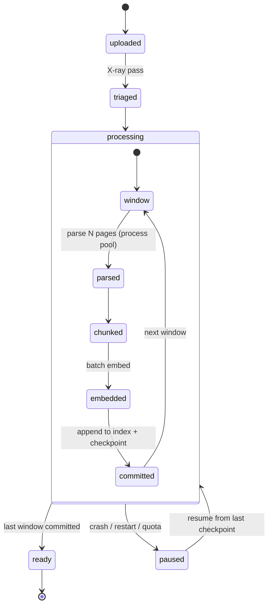
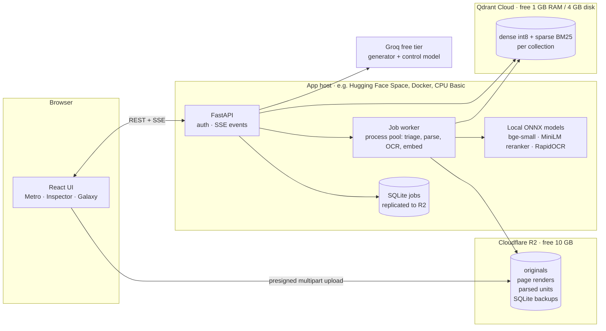

# Plan v2: any-size documents, a live RAG visualizer, and a feature deck

Status: **Phases 0 to 5 built** (DECISIONS.md 25 to 36; measurements in `results/`). Phase 4,
the Galaxy, is on the side branch `feat/galaxy` as decided. Phase 6 (deploy) is not built. Written 2026-11-13 after reading the code on branch `ccr-0fbd0e60-zbgwzn`
(`hyper-rag/`, commit `78286df`).

Constraints decided with the user:

- Stack: Python API (FastAPI, the existing engine) + a React UI.
- Documents that must work: large PDFs and books (100 MB to 1 GB+), scanned/OCR-heavy files,
  and big Office files (DOCX, PPTX, XLSX).
- Budget: **free tier only, and it must be hostable.** Running only on a laptop is not enough,
  because the app will be deployed.

The plan has four parts:

1. [Where the system is today](#1-where-the-system-is-today), with the exact places that break on big files
2. [Feature A: documents of any size](#2-feature-a-documents-of-any-size)
3. [Feature B: a live, animated view of the RAG pipeline](#3-feature-b-a-live-animated-view-of-the-rag-pipeline)
4. [Feature deck: ideas for later](#4-feature-deck-ideas-for-later-not-to-be-built-yet). None of these is built until a real user flow justifies it.

After those come [the free-tier deployment shape](#5-free-tier-deployment-shape),
[phases and acceptance tests](#6-phases-milestones-and-acceptance-tests),
[risks](#7-risks-and-open-questions) and [sources](#8-sources).

---

## 1. Where the system is today

### How data moves now

```mermaid
flowchart LR
    U[Browser: drop file] -->|POST multipart, whole file| API[/collections/c/files/]
    API -->|file.file.read limit+1: whole file in RAM| ADD[CollectionStore.add_file<br/>holds the store lock]
    ADD --> P[parse_file<br/>pdfplumber page loop<br/>RapidOCR on scans and images]
    P --> J[parsed/id.json<br/>all units in one JSON]
    J --> C[chunk_documents<br/>1,200 chars, 150 overlap]
    C --> E[embed_documents<br/>all chunks in one call]
    E --> N[index/id/embeddings.npy + chunks.jsonl]
    N --> R[retriever: np.vstack of every file<br/>+ rank_bm25 over every chunk, in RAM]
    Q[Question] --> AG[LangGraph agent<br/>condense, retrieve, grade, rewrite, generate, check]
    R --> AG
    AG -->|SSE: step text lines, then the answer| UI[index.html, vanilla JS]
```



The engine is careful. It does hybrid retrieval with reranking, cites the page, fails
closed, and has a measured eval harness. Its weak point is scale. Every stage assumes that
one file fits in memory and finishes inside one HTTP request.

### What breaks on a 1 GB book, and where

| # | Problem | Where | Effect on a big file |
|---|---|---|---|
| 1 | The whole upload is read into RAM | `api.py` `upload_file`: `file.file.read(limit + 1)` | 1 GB of RAM before parsing starts. The free hosts' proxies cut long uploads. |
| 2 | The upload cap is 25 MB | `config.py` `max_upload_mb = 25` | Rejected outright |
| 3 | Books are cut at 300 pages, silently except for one warning | `config.py` `max_units_per_file = 300`, `pdf.py` `parse_pdf` | Pages after 300 are never indexed |
| 4 | Parsing and embedding run inside the request | `add_file` is called from the route handler | A one-hour OCR job means a one-hour HTTP request. Proxies time out, and a dropped tab loses the work. |
| 5 | **One lock covers parse, embed and save** | `add_file`: `with self._lock:` wraps everything; `retriever()` takes the same lock | While a big file is being processed, **nobody can ask a question in any collection**, and no other upload proceeds |
| 6 | pdfplumber reads every page | `parsing/pdf.py` | Slowest and most memory-hungry option. A published benchmark: about 57 s and 5.5 GB for 520 pages, against about 0.75 s and 104 MB for pypdfium2. Vendor numbers, so measure them. |
| 7 | All units go into one JSON, reloaded for every citation click | `_parsed_path`, `units()`, `source()` | Opening one citation of a 2,000-page book parses a JSON file of tens of MB |
| 8 | Every chunk is embedded in one call | `_build_index` | Peak memory scales with the book. No progress and no partial result. |
| 9 | The retriever stacks every file's matrix and rebuilds BM25 over the whole collection, and **any upload clears the cache** | `retriever()`, `_save()` pops `_retrievers` | RAM grows with the corpus. Each upload triggers a full rebuild. |
| 10 | No checkpoints | the whole pipeline | A crash at page 900 of 1,000 starts over from page 1 |
| 11 | No login | `api.py` docstring | Must change before any hosting: anyone with the URL could read and delete every document |
| 12 | Local disk is the store | `data/` | Free hosts have ephemeral disks, so files and indexes vanish on restart |

The first thing to understand is that **megabytes are not the problem; work is.** A 1 GB PDF
is usually large because of images: a scanned book, or high-resolution figures. A 1,000-page
text book holds about 2 to 4 MB of actual text, roughly 3,000 chunks. That text is cheap to
embed and to store. What costs time is OCR on scanned pages and layout analysis on complex
ones. The design below separates the bytes, which are moved and stored but never held, from
the work, which is measured, scheduled, checkpointed and parallelised per page.

---

## 2. Feature A: documents of any size

### Design principles

1. **Stream, never hold.** No step holds a whole file, a whole parse result or a whole
   index in memory.
2. **The page is the unit of work.** Every stage works on a window of pages and writes a
   checkpoint when the window is done.
3. **Usable before finished.** Pages become searchable as soon as their window commits.
4. **Spend effort where it pays.** A cheap first pass classifies every page, and only the
   pages that need it get the expensive treatment.
5. **Never do the same work twice.** Results are cached by content hash per page, not per file.

### The ideas, from basic to inventive

#### A1. Resumable, chunked upload where the bytes skip the app server

The browser cuts the file with `Blob.slice()` into parts of 8 to 16 MB and uploads them one
at a time, retrying parts that fail. A lost connection resumes from the last part instead of
starting over. There are two ways to build this.

- **Option 1, recommended: direct to object storage.** The API hands out presigned multipart
  URLs for Cloudflare R2: 10 GB of storage free, free egress, S3-compatible. The browser
  uploads straight to R2, so the app server never sees the 1 GB. This needs a CORS rule on the
  bucket, and parts must be at least 5 MiB. When the upload completes, the API queues a
  processing job.
- **Option 2: through the API, using the tus protocol.** `tuspyserver` is a FastAPI router.
  Parts are appended to disk, and the SHA-256 is updated part by part, so the server never
  holds the whole file. It is simpler, but the bytes cross the app server, and the free host's
  ephemeral disk then needs a copy in R2 anyway.

Either way, the 25 MB cap becomes a per-collection storage budget, checked against R2's
free 10 GB.

#### A2. "X-ray pass": triage every page in seconds before doing any real work

Before parsing, a pass with **pypdfium2** (already a dependency) runs over every page. It
only records, for each page:

- characters in the text layer, and the share of the page covered by images
- vector lines (a table hint), a two-column hint, and the outline/bookmark entry
- a perceptual hash of the low-resolution render, used for duplicate and blank detection

Each page then gets a route:

| Route | Rule (first guess, tuned on real files) | Parser |
|---|---|---|
| `fast-text` | Text layer present, no ruled lines, one column | pypdfium2 text only: about 1 ms per page |
| `layout` | Ruled lines or two columns detected | The existing pdfplumber code, only for these pages |
| `ocr` | Under 25 characters of text (the current `SCANNED_PAGE_CHARS`) | RapidOCR on a render |
| `images` | Text layer plus large images | `fast-text`, plus OCR on the image crops |
| `skip` | Blank, or an exact duplicate of an earlier page | Nothing; noted in the report |

The pass costs seconds even on a 2,000-page book, and it gives the user **a cost estimate
before any heavy work starts**:

> 1,240 pages: 1,050 plain text (about 1 min), 140 with tables (about 4 min), 46 scanned
> (about 2 min), 4 blank. Repeated header and footer found on 1,180 pages, removed.

Header and footer removal falls out of the same pass. Lines that repeat at the same position
on most pages, such as a running title or "Page 12 of 900", are stripped. Today they
pollute BM25 and appear in every chunk.

#### A3. Ingestion as a background job, checkpointed per window of pages



- **Job table in SQLite**, which needs no Redis on a free tier. It holds `jobs(id, file_id,
  state, pages_total, pages_done, eta, error)` and `windows(job_id, first_page, last_page,
  state, ms)`.
- **Workers.** OCR and layout parsing are CPU-bound, so they run in a `ProcessPoolExecutor`
  with one worker per vCPU, two on the free host. Embedding runs in batches of 64 to 256 chunks.
- **Window size** is 16 to 32 pages, so peak memory is set by the window size and not the
  book size.
- **The lock problem (#5) disappears.** The store lock only guards metadata writes. Reads never
  wait for ingestion.
- **Parsed units are stored per page** as SQLite rows or JSONL lines instead of one JSON, so a
  citation click reads one row (#7).
- The 300-page cap goes away. A per-collection page budget replaces it, as a safety valve on
  the free tier.

#### A4. Read while it reads: progressive availability

The index is append-only. Each committed window is visible to search at once. While a book
is still processing, the chat works and says so honestly, for example "Searched pages 1 to
412 of 1,240 (still reading)". The citation panel can already open those pages.

#### A5. Just-in-time deep parsing, driven by the question (the inventive one)

The X-ray pass already holds the cheap text layer of every page that has one. Index that
text in BM25 at once as **tier 0**: the whole book is keyword-searchable within seconds.
Then, when a user asks a question during ingestion:

1. Run the question against the tier-0 keyword index to find the likely pages.
2. **Move those pages to the front of the processing queue.** They get full parsing,
   embeddings and OCR of their images first.
3. Answer from the fully processed pages, and note in the UI which pages were promoted.

The book is processed in the order the user's curiosity needs it, not front to back. For
scanned pages, which have no text layer, tier 0 has nothing to go on. There, the outline/TOC
and the OCR of the first lines of each page give a rough first map.

#### A6. Page-level content cache: a new edition costs only its changed pages

Each page's render hash keys its parse and OCR result. When a user uploads version 2 of a
900-page manual, only the 14 pages that changed are processed again. Today, a new file hash
means everything is processed again. The same cache makes a crash-resume cost nothing for
the work already done.

#### A7. A disk-backed, quantized index instead of in-memory matrices

The current `DenseIndex` and the `rank_bm25` index are both full in-memory structures that
are rebuilt on every change (#9). Behind interfaces, so that tests and the offline mode keep
the current implementations (decision 3 in `DECISIONS.md`):

| Interface | Offline / tests (today) | Hosted (new) | Why |
|---|---|---|---|
| `VectorStore` | numpy matrix | **Qdrant Cloud free cluster** (1 GB RAM, 4 GB disk, single node), int8 scalar quantization, originals on disk | Survives restarts, grows without RAM, and supports filtering by collection and file. Quantization is not gated behind a paid tier. |
| `LexicalStore` | `rank_bm25` | **Qdrant sparse vectors (BM25 with IDF)** in the same collection, *or* SQLite FTS5 | Hybrid search with RRF fusion runs server-side in one Qdrant query, so no BM25 rebuild happens in the app |
| `BlobStore` | local `data/` folder | **Cloudflare R2** | Originals, page renders and parsed units survive restarts |
| `JobStore` | SQLite on local disk | SQLite, replicated to R2 (for example with Litestream; check its R2 support) | Job state survives a free-host restart |

A rough capacity check: bge-small vectors have 384 dimensions, so 1.5 KB each as float32 and
about 0.4 KB with int8. A 1,000-page text book is about 3,000 chunks, around 1.2 MB of
quantized vectors. **The free Qdrant cluster holds hundreds of books' worth of vectors.** The
binding limits are OCR time and R2's 10 GB for originals.

**Regression rule:** before `VectorStore`/`LexicalStore` changes become the default, run
`hyper-rag eval-retrieval` on the payments and papers packs with both implementations. Recall@5,
MRR and nDCG must not drop beyond one question's worth.

#### A8. Book structure: outline-aware chunks and a summary tree (RAPTOR-lite)

Top-k chunk retrieval cannot answer "What is chapter 7 about?" or "How does the argument
develop across the book?". The RAPTOR paper solves this with a tree of recursive summaries.
Leaves are chunks, clusters are summarised, and a "collapsed tree" search covers every level
at once. Their reported gains are largest on long-document QA such as QuALITY and NarrativeQA.
On a free tier, a full RAPTOR build over a book would spend the daily token budget, so the
plan is a cheaper version:

1. **Use the PDF outline** (pypdfium2 `get_toc()`) or the detected headings to assign every
   chunk a `chapter > section` path. Chunks never cross a chapter boundary, and the path goes
   into the chunk title, as headings do now.
2. **Section summaries are extractive and free:** the few sentences closest to the section's
   embedding centroid, computed with the local embedder. No LLM call.
3. **Chapter summaries come from one LLM call per chapter**, written from the extractive
   section summaries, not from the raw text. A 40-chapter book takes about 40 small calls, made
   **lazily**: only on the first "global" question about that book, then cached.
4. **Summary nodes go into the same index** with a `level` field. Questions that look global
   ("summarise", "overall", "compare chapters") search the summary levels first.

This needs its own small golden set of long-book questions before and after. Tables in the
README only report measured numbers, so this one does too.

#### A9. Large Office files

- **XLSX:** the parser already uses `read_only=True`, which streams. The problem is
  conceptual. Embedding 500,000 spreadsheet rows as text chunks is wasteful and answers sums
  badly. Big sheets get a **table profile** (columns, types, ranges, a few sample rows) that is
  embedded for retrieval, and the data itself goes into DuckDB, held in memory per question or
  as Parquet in R2. Numeric questions then go to SQL. That last part is deck item D3; for now,
  profiles plus a row cap per sheet.
- **DOCX and PPTX:** python-docx and python-pptx load the whole XML tree. That is fine up to
  hundreds of MB, because most of a large DOCX is embedded images, which are OCRed per image.
  Keep these parsers, run them inside the job worker, and checkpoint per section or per
  20 slides.

#### A10. Alternative idea, not the default: ingestion at the edge, in the user's browser

On a free host, the server's CPU is the scarce resource. The user's laptop is not. The
browser could do the expensive steps itself: pdf.js extracts the text layer, Transformers.js
runs the same bge-small model (an ONNX export) to embed, and tesseract.js does OCR. The
server only receives text and vectors. It turns the free-tier bottleneck around, and the
ingestion animation would show work actually happening on your own machine. The costs: the
tab has to stay open, phones are slow, browser OCR is weaker than RapidOCR, and query and
document embeddings must come from the same model at the same quantization. Keep this as a
spike for later, behind a toggle.

### What it will look like to the user

```
Files  ▸  Linear-Algebra-Done-Right.pdf    812 MB   1,240 pages
  Upload     ████████████████████ 100%   resumed once after a dropped connection
  X-ray      1,050 text · 140 tables · 46 scanned · 4 blank   (est. 7 min)
  Reading    ███████████░░░░░░░░░  58%   pages 1-720 searchable, ETA 3 min
             ▸ 6 pages moved ahead for your question "eigenvalues of a rotation"
  [page grid: one cell per page, colour = route, fills as each window commits]
```

---

## 3. Feature B: a live, animated view of the RAG pipeline

### The rule that makes it worth building

**Every animation must be driven by real events from the engine, not a canned loop.** If the
reranker reorders five passages, the screen shows those five passages moving. That is what
turns a pretty view into a tool you can **measure, analyse and evaluate** with. It also means
the backend change comes first, and the UI comes second.

### B0. An event stream with structure, not trace strings

Today the stream sends `{"type": "step", "text": "grade: 2 of 5 relevant"}`. The new stream
sends typed events with timings and the actual objects involved:

```jsonc
// ingestion (per job, over SSE: GET /collections/{c}/jobs/{id}/events)
{"t":"ingest.triage",  "pages":1240, "routes":{"fast-text":1050,"layout":140,"ocr":46,"skip":4}}
{"t":"ingest.page",    "page":37, "route":"ocr", "ms":1840, "chars":2210}
{"t":"ingest.chunks",  "page":37, "chunks":[{"id":"ab12/37#0","xyz":[0.12,-0.4,0.9]}]}
{"t":"ingest.commit",  "window":[33,64], "searchable_pages":64}

// a question (POST /collections/{c}/ask/stream)
{"t":"q.condense",  "standalone":"What is the battery warranty?", "ms":410, "tokens":96}
{"t":"q.embed",     "xyz":[0.3,0.1,-0.2], "ms":9}
{"t":"r.dense",     "hits":[{"id":"…","rank":1,"score":0.83}, …30]}
{"t":"r.bm25",      "hits":[…30]}
{"t":"r.fuse",      "hits":[…20]}
{"t":"r.rerank",    "hits":[…5], "top_score":7.9, "ms":120}
{"t":"a.grade",     "kept":["…","…"], "dropped":["…"], "ms":650, "tokens":1400}
{"t":"a.rewrite",   "query":"…", "attempt":1}
{"t":"a.generate",  "ms":2100, "tokens_in":2900, "tokens_out":120}
{"t":"a.check",     "grounded":true, "ms":700}
{"t":"answer",      … the current AnswerResponse …}
{"t":"llm.quota",   "model":"groq:openai/gpt-oss-120b", "requests_left_today":999, "tokens_left_this_minute":7907}
```

As built in phase 0 (`hyper_rag/events.py`): the stream sends these as
`{"type": "event", "t": ..., ...}` next to the existing step lines. Agent decisions are
`a.route`, `a.retrieve` (query and attempt), `a.grade`, `a.rewrite`, `a.generate`, `a.check`
and `a.decline`; each model call carries `ms`, `model`, and `tokens_in`/`tokens_out` or
`cached` when known. Groq reports no daily token counter, so `llm.quota` carries requests
left today and tokens left this minute (DECISIONS.md 26). `xyz` coordinates are not emitted
yet; they belong to the Galaxy, which moved to a side branch.

- Events are emitted by the nodes in `agent/graph.py` and by the `Retriever` through an
  optional `on_event` callback, so the current `ask()` and `ask_events()` keep working.
- The last answers' events are **saved**, which makes the replay feature below free.
- The `quota` event comes from the provider's rate-limit response headers, so the user can
  see the free tier's budget run down. Check which headers Groq sends today.
- **3D coordinates.** The view needs every chunk placed in 3D:
  - **Live: PCA**, fitted once per collection in numpy. A new chunk or a question is placed
    with one matrix multiply, so positions are instant and stable as pages arrive.
  - **Optional "pretty layout": UMAP**, computed in the background when ingestion finishes. The
    question is then placed at the score-weighted centroid of its top neighbours. This is
    honest: it lands among what it actually retrieved.
  - **Honesty label:** a 3D projection distorts distances. The view always prints the real
    cosine and rerank scores next to points. The picture is the map, and the numbers are the
    territory.

### Three visual concepts

#### Concept 1: "Pipeline Metro", a 2D flow map (most understandable)

Two metro lines drawn with **React Flow** (`@xyflow/react`) and animated with **Motion**
(framer-motion). Each station shows live counters and timings. Dots that represent pages,
chunks or the question travel along the lines.

```
INGEST  ●──X-ray──●──Parse──●──Chunk──●──Embed──●──Index──▶ 720 / 1,240 pages
        1,240 p   │ 46 OCR  │ 2,180   │ 64/s    │ Qdrant
                  ▼ 12 s/p  │         │         │
QUERY   ●──Condense──●──Embed──●═╦═Dense 30═╦══●──RRF 20──●──Rerank 5──●──Grade 2──●──Write──●──Check ✓──▶ Answer
        410 ms       9 ms        ╚═BM25 30══╝    1 ms       120 ms       650 ms      2.1 s     0.7 s
                                        ▲                                  │
                                        └────── Rewrite (attempt 1) ◀──────┘ none relevant
```

- **Good for:** understanding and measuring. Every number is a real value, and clicking a
  station opens its inspector, for example the 30 dense hits with scores.
- **Cost:** low. It is 2D and DOM-based, accessible, and fast on any laptop or phone.
- **Teaches:** the shape of RAG, including the corrective loop and where the time goes.

#### Concept 2: "Knowledge Galaxy", a 3D embedding space (most impressive)

Built with **three.js + react-three-fiber + drei** (`Instances` for tens of thousands of
points, `Html` for labels) and **@react-three/postprocessing** for bloom. Each chunk is a
star, coloured by file, so topic clusters show up as constellations.

- **Ingestion:** a document card opens and its pages slide out. Each page shatters into chunk
  particles that fly to their PCA positions. The galaxy fills up as the book is read.
- **Question:** the typed question condenses into a comet and lands at its projected position.
  A radar pulse spreads out:
  - Dense hits light up blue and BM25 hits light up amber. Stars found by both turn white:
    that is RRF fusion.
  - The reranker pulls the top 5 into orbit around the comet, ordered by score.
  - The grader dims the rejected ones to grey.
  - The kept passages stream as beams into an "LLM core" at the centre, which emits the answer.
  - Each citation `[n]` in the answer is linked to its star. Hover one and the star pulses.
- **Rewrite loop:** the comet jumps to the rewritten query's position, and the search
  visibly happens again somewhere else.
- **Good for:** the "wow" moment, demos, LinkedIn videos, and spotting clusters of documents
  that never get retrieved.
- **Cost:** GPU and battery, harder accessibility, and distorted distances, so labels show
  true scores. It needs a reduced-motion fallback.

#### Concept 3: "Rank Race" and "Page Grid", 2D forensic views (most analytical)

- **Rank Race**, an animated bump chart drawn with D3 scales and Motion. Each candidate passage
  is a line, and the columns are Dense rank → BM25 rank → RRF → Rerank → Kept/Dropped. You
  watch a passage that BM25 found at rank 14 climb to rank 1 after reranking. This answers
  **"why was this passage cited and that one not?"**, the most useful debugging question in RAG.
- **Page Grid** for ingestion: one cell per page of a 1,240-page book, coloured by route
  (text, table, OCR, skipped, failed). Cells fill as windows commit, pages moved ahead by a
  question flash, and hovering shows a page's timing, character count and warnings. Feature
  A's progress becomes something you can see and inspect.
- **Waterfall** per answer, like the network tab in browser devtools: one bar per stage, with
  milliseconds and tokens.

### Recommendation: combine them, in layers of detail

The concepts answer different questions, so they are not competitors. Build them in this
order:

1. **B0 events** (backend). Nothing else is honest without them.
2. **Concept 1 (Metro) as an always-visible strip**, plus the **waterfall** on each answer.
   This is the daily-use view.
3. **Concept 3 (Rank Race + Page Grid)** in the inspector, for drill-down.
4. **Concept 2 (Galaxy)** as an "Explore" view and a presentation mode.

### Where it goes in the interface

The current three-pane layout (collections | chat/files/eval | source) is good and stays.
The visualizer is added at three depths, so the default view never adds cognitive load:

```
┌────────────┬────────────────────────────────────────────────────┬──────────────────────────┐
│ Hyper-RAG  │ Solar docs   9 files · 57 passages · Groq 171K left │ INSPECTOR                │
│            │ Chat  Files  Evaluation  Explore                   │ [Source][Retrieval][Space]│
│ COLLECTIONS├────────────────────────────────────────────────────┤                          │
│ ▸ Solar    │ ① PIPELINE STRIP (Metro, 72 px, always visible)     │ ③ context of the selected │
│   docs     │ ●Condense─●Embed─●Dense/BM25─●RRF─●Rerank─●Grade─… │   answer or station:     │
│ ▸ Books    │   410ms    9ms     30 / 30     20    5     2/5     │                          │
│            ├────────────────────────────────────────────────────┤  Source: the page, with  │
│ PACKS      │  You: What is the warranty on the inverter?        │  the passage highlighted │
│  payments  │                                                    │  (exists today)          │
│  papers    │  The inverter has a 10-year warranty… [1]          │                          │
│            │  ② ▸ waterfall ▇▇▁▇▇▇▇▇▇▁  4.1 s · 3 calls · ↻ replay│  Retrieval: Rank Race    │
│ INGESTING  │  [1] guide.pdf p.2 › Warranty                      │  for this answer         │
│ ▸ book.pdf │                                                    │                          │
│   58% ▓▓▓░ │  ┌──────────────────────────────────────────────┐  │  Space: mini galaxy, the │
│            │  │ Ask a question about these documents     Ask │  │  question and its top 5  │
└────────────┴──┴──────────────────────────────────────────────┴──┴──────────────────────────┘
```

- **① Pipeline strip:** top of the chat view, 72 px, always visible. It shows the live state
  of the current question; when idle it shows the last one. Click a station → the inspector
  opens on that station.
- **② Per-answer waterfall:** collapsed to one line under each answer, it replaces the current
  "What the agent did" text list. A **replay** button re-animates the strip and inspector from
  the saved events.
- **③ Inspector tabs** in the existing right panel: **Source** (today's panel), **Retrieval**
  (Rank Race), **Space** (mini galaxy focused on this question).
- **Explore tab:** the full-screen galaxy plus a metrics board. It shows latency per stage over
  the last N questions, LLM calls and tokens per answer, the daily quota meter, a histogram of
  the top rerank score (the out-of-scope signal already on the README's to-do list), and the
  share of chunks never retrieved.
- **Files tab:** the Page Grid for each file that is processing, with the X-ray estimate.
- **Left nav:** a small "Ingesting" section, so a long job stays visible from every view.
- **Accessibility:** `prefers-reduced-motion` swaps animations for instant state changes.
  Every visual has a table or text equivalent, colours are checked in light and dark themes,
  and the galaxy is never the only way to read a result.

### Libraries

| Need | Library | Notes |
|---|---|---|
| App shell | React + Vite + TypeScript | Built to static files and served by FastAPI, so it stays one deployable |
| Flow map | `@xyflow/react` | Custom node types for stations |
| 2D motion | `motion` (framer-motion) | Layout animations for the rank race and lists |
| Charts | `d3-scale`, `d3-shape` (+ Motion) or `visx` | Bump chart, waterfall, histograms |
| 3D | `three`, `@react-three/fiber`, `@react-three/drei`, `@react-three/postprocessing` | Check drei's React 19 support before pinning versions |
| Server state | TanStack Query + a small SSE hook | |
| Projection | numpy PCA (live), `umap-learn` (background, optional) | umap-learn pulls numba. Keep it optional so the install stays small. |

Pin exact versions, as the Python side already does.

---

## 4. Feature deck: ideas for later (not to be built yet)

These are **position cards, not commitments.** Each one has a hypothesis and the real user
flow that must exist, and be observed, before it is built. A card is promoted only when:
(1) that flow has happened at least three times in real use, (2) a success metric is written
down, and (3) a free-tier cost estimate fits the budget.

Impact and effort: H/M/L. Free-tier risk is how likely the feature is to exhaust a free quota.

### Daily-driver features

| # | Feature | What it does | Impact | Effort | Free-tier risk | Promote when |
|---|---|---|---|---|---|---|
| D1 | **Hyper-RAG as an MCP server** | Exposes `list_collections`, `ask`, `search`, `get_source` as MCP tools, so Claude Code, Gemini CLI and n8n can query your documents. It fits what this repository is about: AI CLIs and agents. | H | L | L | You want to ask your documents from inside a coding or writing session |
| D2 | **Watch folders and connectors** | Syncs from Google Drive, Notion and GitHub, re-indexing only changed pages (uses A6). It replaces the n8n Drive→Pinecone flow in `architecture/AI_Powered_Document_Assistant.excalidraw`. | H | M | M | You re-upload the same sources by hand more than once a week |
| D3 | **Spreadsheet brain** | Questions over XLSX/CSV are answered by SQL on DuckDB, with a cited result table and a chart | H | M | L | A numeric question over a sheet is answered wrongly by text RAG |
| D4 | **Claim checker** | Paste any text, such as a post draft, a report or a model's answer. Each claim is checked against your documents and shown as supported, contradicted or not found, with citations. Reuses the groundedness check. | H | M | M | You fact-check something against your own sources by hand |
| D5 | **Study mode for books** | Chapter summaries (A8), flashcards and quizzes generated from passages, spaced repetition, and "explain this page simpler" | H | M | M | You use a book collection for learning, such as the ML intern prep in `docs/` |
| D6 | **Answer → artifact** | Exports an answer with citations to Markdown, a Notion page, or a LinkedIn post or carousel outline. The repository already has writing skills for those. | M | L | L | You copy answers into another tool more than a few times a week |
| D7 | **Ask across everything** | One question over all collections, with the reranker's top score per collection deciding which ones are in scope | M | M | L | You forget which collection holds what |

### Power features

| # | Feature | What it does | Impact | Effort | Free-tier risk | Promote when |
|---|---|---|---|---|---|---|
| P1 | **Version diff** | "What changed between v1 and v2 of this contract?" Page hashes find the changed pages, and an LLM summarises the meaningful differences with citations to both versions. | H | M | M | You receive revised versions of the same document |
| P2 | **Vision captions for charts and photos** | An opt-in Gemini Flash free-tier pass describes figures that OCR cannot read. It fixes the README's limitation that OCR reads text, not pictures. | M | M | H | A question fails because the answer is in a chart |
| P3 | **Saved questions and alerts** | Saves a question; when a new upload changes its answer, you are notified | M | M | M | You ask the same question repeatedly as documents arrive |
| P4 | **Entity and timeline view** | Extracts people, organisations, dates and amounts across a collection into a graph and a timeline (GraphRAG-lite) | M | H | H | Your questions are about relationships, not passages |
| P5 | **Highlights and notes** | Highlight in the source panel and add a note. Notes become searchable passages, marked as yours. | M | L | L | You want to keep what you learned from an answer |
| P6 | **Confidence badge** | Each answer gets a calibrated badge from the rerank score, the grade ratio and the check result, calibrated on the eval sets | M | L | L | You notice you cannot tell strong answers from weak ones |
| P7 | **Voice in, voice out** | Asks by voice through Whisper on Groq (check it is still on the free tier); answers read aloud | L | L | M | You use it on a phone or while away from the keyboard |
| P8 | **Daily digest** | A morning summary of what was added and which saved questions changed | L | L | M | You have more than a few uploads per week |
| P9 | **Shareable read-only collections** | Share a collection link, read-only, with its own question quota | M | M | M | Someone else asks you questions about your documents |

### Platform prerequisites (not features, but needed before hosting)

- **Authentication:** today anyone who can reach the URL can read and delete everything (#11).
  The minimum before deployment is a single-user password or a magic link and a session
  cookie. Accounts come with P9.
- **Per-user quotas**, so one runaway job cannot spend the whole Groq or Qdrant free tier.
- **Encryption at rest:** R2 already encrypts, so the remaining work is keeping keys out of
  logs and events.

---

## 5. Free-tier deployment shape



Notes and verified-or-not status:

- **App host.** Hugging Face Spaces' documented free CPU Basic tier is 2 vCPU, 16 GB RAM and
  50 GB of **non-persistent** disk. That is enough for the ONNX models and OCR. Forum
  threads in 2026 report quota changes and disputes about free Docker Spaces. **Confirm this is
  available on your account before building on it.** Render's free tier (512 MB RAM, sleeps
  after 15 minutes, no persistent disk) is too small for OCR and embedding together. Fly.io has
  no free tier for new accounts. If no host with enough RAM is free, A10 (edge ingestion)
  becomes the main path rather than a spike.
- **Ephemeral disk is fine** in this design: nothing important lives only on local disk.
  Model files are re-downloaded or baked into the Docker image.
- **Cold starts.** A sleeping free host takes tens of seconds to wake. The UI should show a
  "waking up" state rather than an error.
- **Qdrant free cluster:** 0.5 vCPU, 1 GB RAM, 4 GB disk. One third-party source claims it
  pauses after a week of inactivity, which is unverified. A paused cluster would mean the
  first query after a quiet week fails, so handle that error clearly.
- **Groq free plan** (from `config.yaml`): 30 requests/min, 8K tokens/min and 200K
  tokens/day **per model**. That budget is why A8 is lazy and extractive-first, and why the
  quota meter in Feature B matters.
- **Gemini free tier:** per-model limits are not published in the docs, only in AI Studio, and
  were cut in 2026. Treat it as a fallback, not a dependency.

---

## 6. Phases, milestones and acceptance tests

Each phase ends with a measured result, in the same style as the existing README: the
command, the number, and what it does *not* show.

| Phase | Scope | Acceptance test (measured, written down) |
|---|---|---|
| **0. Foundations** | `BlobStore` / `VectorStore` / `LexicalStore` / `JobStore` interfaces with the current implementations; the typed event bus (B0) behind `on_event`; React + Vite scaffold served by FastAPI and matching today's UI; single-user auth | All 83 existing tests pass; offline CI eval unchanged; the new UI covers today's flows. **Backend done:** 85 existing tests pass (one updated for the new stream contract) plus 28 new; offline eval output identical; collection retrieval identical on 18 query/mode pairs. **React app done:** every flow of the classic page passes in a browser (`web/e2e/flows.mjs`, in CI), against uvicorn and the Docker image. |
| **1. Big files** | A1 resumable upload, A2 X-ray, A3 job windows + checkpoints, A4 progressive search, per-page unit storage, lock split, caps replaced by budgets | 1 GB synthetic PDF and a real public-domain scanned book: peak RSS stays under a fixed bound (target 1.5 GB) whatever the file size; `kill -9` mid-job resumes with no repeated window; a question asked at 30% ingestion is answered from committed pages; pages/min reported for each route |
| **2. Hosted stores** | Qdrant (dense int8 + sparse), R2, SQLite replication; A6 page cache | `eval-retrieval` on payments and papers: no drop beyond one question; re-upload of a file with 1% of pages changed processes only those pages |
| **3. Visualizer v1** | Metro strip, waterfall, replay, Page Grid, Rank Race, inspector tabs | Event-to-screen latency under 100 ms; every number on screen matches the saved event log; reduced-motion mode passes a manual check |
| **4. Galaxy** | PCA live layout, optional UMAP, Explore tab, metrics board | 50+ fps with 20,000 points on an integrated GPU; the question point and top 5 are correct against the event log |
| **5. Book structure** | A5 just-in-time parsing, A8 outline chunks + summary tree | New long-book golden set (about 20 questions, including global ones): report the score before and after, and LLM calls per question |
| **6. Deploy** | HF Space (or the confirmed alternative), env secrets, cold-start UX, quotas | Fresh deploy from README instructions; the app survives a restart with no data loss |

Test corpus for Phase 1:

- A generated 1 GB PDF (reportlab + large images; the fixture script exists in `tests/make_files.py`)
- A public-domain scanned book (for example from the Internet Archive) for OCR
- A long text book or thesis for structure
- A 200,000-row XLSX

Large files are generated or downloaded at test time, never committed.

---

## 7. Risks and open questions

| Risk | Mitigation |
|---|---|
| The free CPU host disappears or shrinks | Keep the app runnable on any Docker host; A10 edge ingestion as fallback; nothing important stored on local disk |
| OCR throughput: a 1,500-page scan could take tens of minutes on 2 vCPUs (estimate, to be measured in Phase 1) | Progressive search, just-in-time ordering, adaptive DPI (150 for clean scans, 200+ on low confidence), skip blanks and duplicates |
| Groq daily token cap during eval and summaries | Lazy summaries, extractive first, caching (exists), a quota meter, and a per-user budget |
| The 3D view misleads, because projected distance is not similarity | True scores always on labels; Rank Race as the authoritative view |
| Visual work crowds out engine quality | Phase 3 cannot start until Phase 1 acceptance tests pass |
| Qdrant hybrid scores differ from today's RRF + rerank | The regression rule in A7; keep the cross-encoder rerank step in the app either way |

**Open questions for you:**

1. Is a Hugging Face Space (public URL, password-protected app) acceptable as the host, or do
   you have another free host in mind?
2. Single user (you) at first, or should Phase 0 auth already support several people?
3. Should the Galaxy be part of the product, or mainly a demo and recording mode? That decides
   whether it is Phase 4 or a side branch.
4. Which deck cards feel closest to your real week? D1 (MCP) and D4 (claim checker) look like
   the strongest fits for how you work, judging by this repository.

**Answers (2026-11-13):**

1. **Host: Hugging Face Space**, with a public URL and a password-protected app. Before
   Phase 6, confirm the free CPU Basic Docker tier is available on the account. If it is not,
   A10 (edge ingestion) becomes the main path, as section 5 says.
2. **Auth: single user at first.** Phase 0 ships a single-user password or magic link with a
   session cookie. Multi-user accounts wait for P9 (shareable collections).
3. **Galaxy: a demo and recording mode on a side branch**, not part of the product. The
   product's visualizer is the Metro strip, waterfall, Rank Race and Page Grid (Phase 3).
   Phase 4 moves off the main path, and nothing in Phases 5 and 6 depends on it.
4. **Deck cards closest to a real week: D1 (MCP server) and D6 (answer → artifact).** These
   are the first candidates for promotion. The promotion rule in section 4 still applies:
   the flow happens three times in real use, a success metric is written down, and a free-tier
   cost estimate fits the budget.

---

## 8. Sources

Checked 2026-11-13. Free-tier details change often, so verify them before relying on them.

- Hugging Face Spaces overview (CPU Basic specs): https://huggingface.co/docs/hub/en/spaces-overview
- HF forum, CPU Basic quota reports: https://discuss.huggingface.co/t/question-about-the-cpu-basic-quota-limit/176628
- HF forum, complaint about free-tier changes: https://discuss.huggingface.co/t/official-community-complaint-revert-free-cpu-basic-spaces-and-remove-anti-developer-sdk-restrictions/177703
- Qdrant Cloud: https://qdrant.tech/cloud
- Qdrant memory tiers: https://qdrant.tech/documentation/production-operations/memory-tiers/
- Qdrant quantization: https://qdrant.tech/quantization/
- Cloudflare R2 free tier and pricing: https://upstash.com/kb/cloudflare-r2-pricing-in-2026-storage-operations-and-real-monthly-bills
- Browser uploads to R2: https://transloadit.com/devtips/browser-uploads-to-cloudflare-r2-with-aws-sdk/
- tuspyserver (tus for FastAPI): https://pypi.org/project/tuspyserver/
- resumable-upload (tus, Python): https://pypi.org/project/resumable-upload/
- PDF extractor benchmarks: https://retsef.github.io/rpdfium/benchmarks/raw-text
- PDF extractor benchmarks: https://dev.to/onlyoneaman/i-tested-7-python-pdf-extractors-so-you-dont-have-to-2025-edition-akm
- RAPTOR paper (arXiv 2401.18059): https://ar5iv.labs.arxiv.org/html/2401.18059
- RAPTOR repository listing: https://sourceforge.net/projects/raptor.mirror/
- Wikipedia 3D embeddings with react-three-fiber: https://github.com/briansunter/wikipedia-3d-embeddings/blob/master/README.md
- latent-space-explorer: https://awesome.ecosyste.ms/projects/github.com%2Fjames-julius%2Flatent-space-explorer
- @arizeai/point-cloud: https://npmjs.com/package/@arizeai/point-cloud
- UMAP 3D projections: https://docs.curiosity.ai/umap/guide/3d-projections
- Free backend hosting, Render: https://render.com/articles/platforms-with-a-real-free-tier-for-developers-in-2026
- Free backend hosting comparison: https://flaviocopes.com/hosting-free-tiers/
- Free backend hosting comparison: https://snapdeploy.dev/state-of-free-hosting
- Gemini Embedding announcement: https://developers.googleblog.com/gemini-embedding-available-gemini-api/
- Gemini free-tier changes: https://agentdeals.dev/gemini-api-pricing-changes
